# Installer Voice Relay sur votre serveur Discord

Voice Relay diffuse en direct la voix de vos Speakers dans plusieurs salons vocaux à la fois.
Un bot principal écoute le salon Speaker, un bot relais par salon Listener répète leur voix.

Durée : 10 minutes environ. Il faut la permission "Gérer le serveur" sur le serveur à équiper.

Site : https://example.sslip.io

---

## 1. Se connecter

Ouvrez le site et cliquez sur "Se connecter avec Discord".
Pas de compte à créer : le site lit seulement votre identité et la liste de vos serveurs.

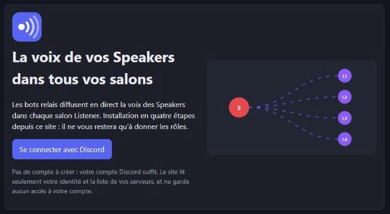

La page "Vos serveurs" liste les serveurs où vous avez "Gérer le serveur".
Cliquez sur "Installer" en face du serveur à équiper.

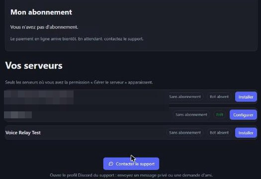

## 2. Inviter le bot principal

Cliquez sur "Inviter Voice Relay".

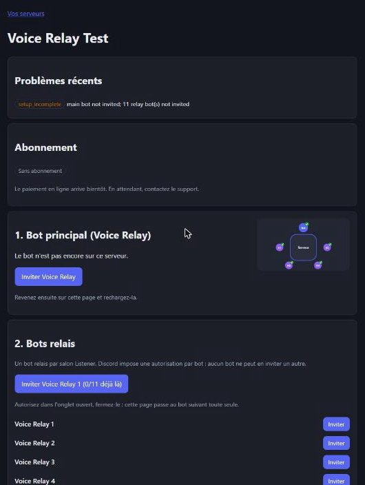

Discord ouvre sa page d'autorisation, serveur déjà choisi. Cliquez sur "Continuer".

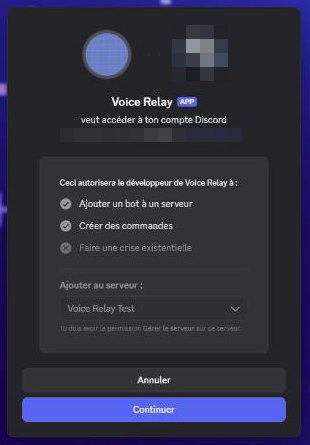

Laissez "Administrateur" coché, cliquez sur "Autoriser".

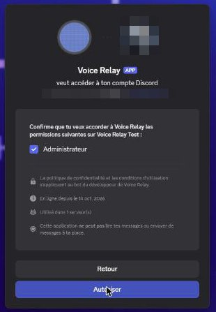

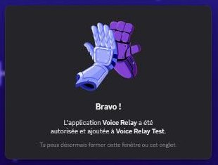

Revenez sur le site et rechargez la page : "Présent sur le serveur" s'affiche.

## 3. Inviter les 11 bots relais

Discord interdit à un bot d'en inviter un autre : il faut une autorisation par bot.

Pour chaque bot, de Voice Relay 1 à Voice Relay 11 :

1. Cliquez sur "Inviter" (ou sur le gros bouton "Inviter Voice Relay N").
2. Dans l'onglet ouvert : "Continuer", puis "Autoriser".
3. Fermez l'onglet et rechargez la page du site.

Faites-les un par un. Ouvrir toutes les invitations d'un coup peut renvoyer Discord vers sa page de connexion.

Quand c'est fini, tous les bots sont marqués "Présent".

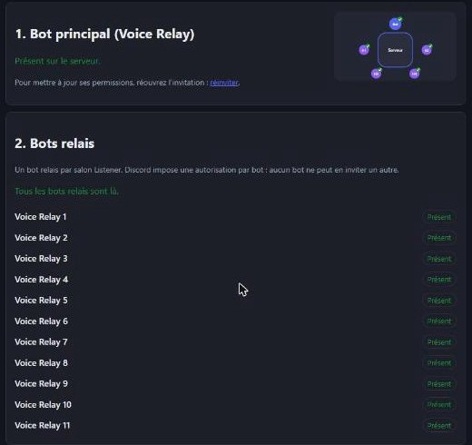

Un bot relais par salon Listener : avec 5 bots, vous aurez 5 salons Listener. Vous pouvez donc n'en inviter qu'une partie.

## 4. Créer les rôles

La section "3. Permissions du bot" doit afficher "Toutes les permissions nécessaires sont accordées".

Dans "4. Rôles", cliquez sur "Créer les rôles manquants". Trois rôles sont créés :

- Speaker : les chefs dont la voix est relayée. Seuls eux entrent dans le salon Speaker.
- Squad Lead : les chefs de groupe, assis dans un salon Listener.
- Listener Access : donné automatiquement à tous les membres. Il rend visibles la catégorie et les salons de session.

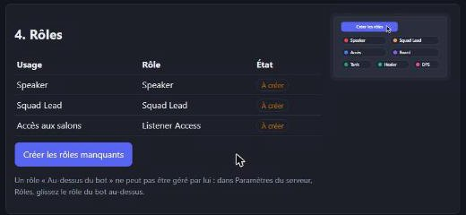

Le site peut afficher "Au-dessus du bot" juste après la création. Vérifiez dans Discord, Paramètres du serveur, Rôles : si "Voice Relay" est au-dessus de Speaker, Squad Lead et Listener Access, tout va bien.

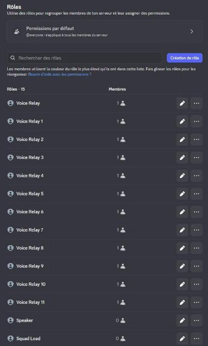

Sinon, faites glisser le rôle "Voice Relay" au-dessus de ces trois rôles.

## 5. Donner les rôles

Le bot a créé une catégorie "Voice Relay" avec le salon #control-panel.

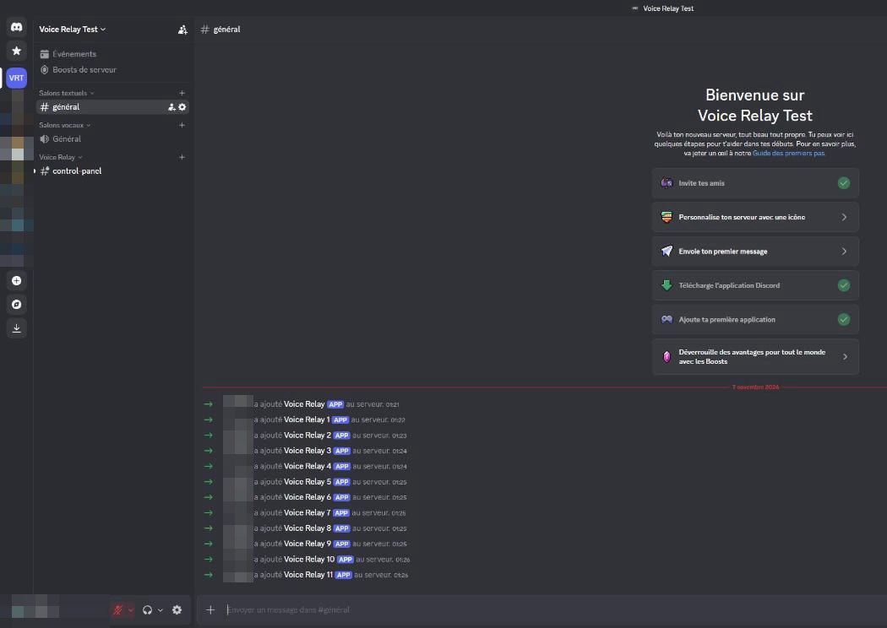

Donnez Speaker à vos chefs : clic droit sur le membre, Rôles, cochez Speaker.
Même chose pour Squad Lead.

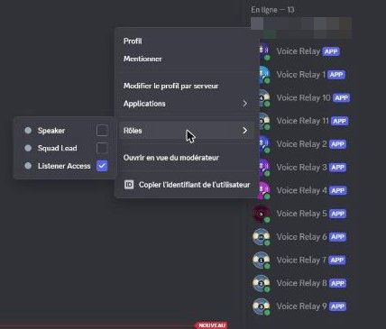

Listener Access est donné tout seul à chaque membre.

## 6. Lancer une session

Le panneau de commande reste affiché dans #control-panel. Seuls les Speakers peuvent s'en servir.

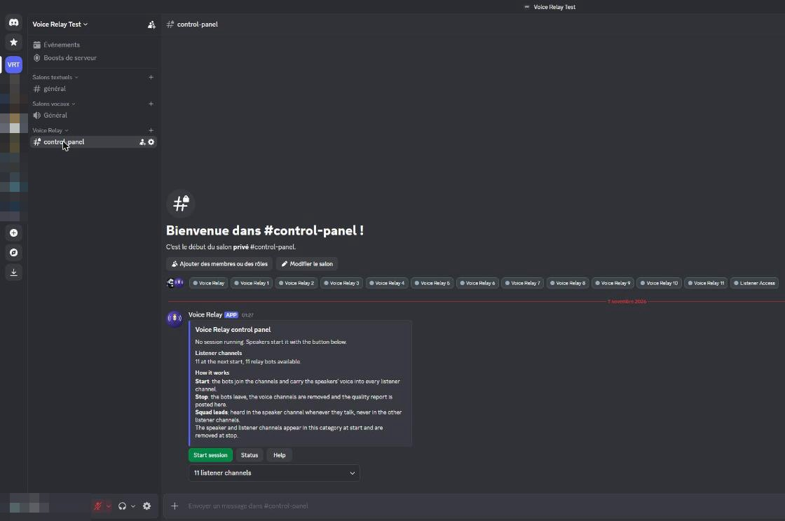

- Liste "N listener channels" : choisissez combien de salons Listener ouvrir.
- "Start session" : le bot crée le salon Speaker et les salons Listener, chaque bot rejoint le sien.

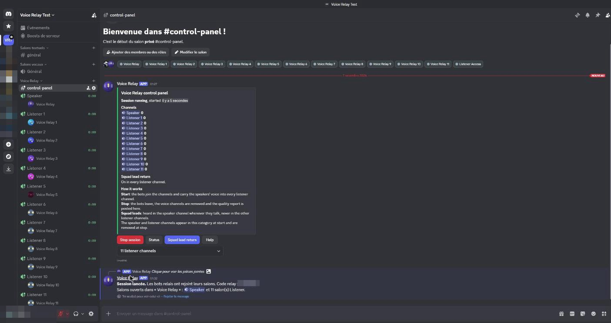

Pendant la session :

- Les Speakers parlent dans le salon Speaker.
- Les autres membres vont dans un salon Listener et entendent les Speakers.
- Un Squad Lead (ou un Speaker) assis dans un salon Listener est entendu dans le salon Speaker, jamais dans les autres salons Listener.

"Squad lead return" (Retour des chefs) coupe ou réactive ce retour, salon par salon. Vert : actif. Rouge : coupé. Tout se réactive au lancement suivant.

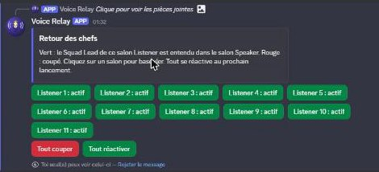

## 7. Arrêter

"Stop session" : les bots quittent les salons, les salons vocaux sont supprimés et un rapport qualité est publié dans #control-panel.

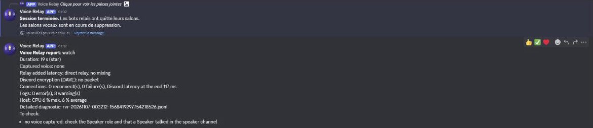

Le rapport s'efface tout seul au bout de 30 minutes.

## Serveur Communauté avec Processus d'accueil

Si votre serveur utilise le Processus d'accueil, Discord peut cacher la catégorie Voice Relay aux membres qui ne l'ont pas choisie.
Chaque membre doit alors, une seule fois : Salons et rôles, Parcourir les salons, catégorie "Voice Relay", "Suivre la catégorie".
Un bot ne peut pas le faire à leur place.

## Désinstaller

En bas de la page du serveur sur le site : cochez la confirmation, puis "Désinstaller".
La session est arrêtée, les salons supprimés, tous les bots quittent le serveur. Les rôles restent.

## Besoin d'aide

Bouton "Contacter le support" en bas du site.
